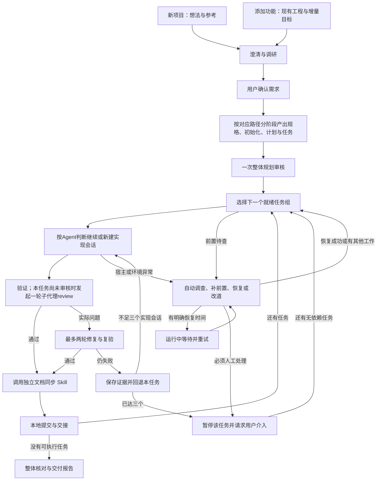

# Autoship 实施方案

2026-11-11。依据需求访谈、Wiki、一手项目源码与 FloatDo 交互形成。已开始搭建最小框架；本文描述完整目标，部分命令和行为仍是拟议接口。当前可运行范围见 [README.md](README.md)，验证进度见 [progress.md](progress.md)。已确认要求见 [DESIGN.md](DESIGN.md)。

## 1. 推荐形态

**一套按阶段加载的 Skills，一个使用标准库的本地接力脚本，以及每种 Agent 的少量接入代码。Hook 按宿主能力选用。**

Skills 承载开发方法和判断；脚本负责启动会话、保存检查点、计数、回退和恢复。任务按当前依赖与优先级串行执行，每次交付一个可验证的任务组。遇到障碍先主动解决、补前置或调整路径，继续推进可做的工作。核心不直接调用模型 API，不引入数据库服务、容器、常驻调度服务或通用工作流框架。

建议 **Node.js 24 LTS 起步，JavaScript ESM，零第三方运行时依赖**。用标准库处理进程、文件和终端输入，以 Git 管理工作区与检查点；用内置测试工具验证恢复逻辑。Node 和 Git 是明确前提，不能称为完全无需运行时。Windows、macOS、Linux 共用核心，启动差异放在接入代码中。[N1][N2]

首版先在 Windows 跑通 Codex，再用 Claude Code 和 OpenCode 检验可移植性；三者作为首批完整适配目标。WorkBuddy 的流程技能和完整自动接力分别评估。

### 必须保持的产品约定

- 用户确认需求后，自动规划、审核、逐任务实现、验证与交接。
- 新项目和添加 feature 分别走独立路径。
- 流程规模随工作难度调整：Agent 决定任务数量及会话分组，小项目可只用 1–2 个 task，一个 session 可以连续执行多个 task，阶段也可以合并；没有固定的任务或会话配额。
- 技术方案与任务安排可自行调整，必须同步文档；产品范围、关键交互与审美方向的变化由用户决定。
- 前端项目显式编写 `design.md` 与 `app_flow.md`；澄清时询问设计风格，没有指定时从 awesome-design-md 随机选取并落盘，后续沿用。
- 项目 `AGENTS.md` 参考 FloatDo 的通用规则；每个 task 有简洁、可执行的 spec，阶段提示词参考 Matt Pocock Skills，讲清任务并保留实现判断空间。
- 规划完成后整体审核一次；每个 task 完成后仅安排一轮独立子代理 review，主 Agent 修复并验证，不重复审核。
- 默认自动前进：未验证前置、登录、额度、进程与权限异常先调查、恢复或改道；记录环境待验项并继续无依赖工作，实际缺陷先修。
- 文档同步由独立、可自动调用的 `autoship-docs-sync` Skill 承担，在需求、计划、实现或运行结果变化时同步相关材料。
- 每个实现会话最多修两轮，同一任务最多三个实现会话；失败回退到任务开始前，保留证据，预算耗尽后暂停该任务并请求介入，其余无依赖任务继续。次数可配置。
- 默认只交付本地可运行结果、文档、验证记录和 Git 提交；明确要求后才推送或发布。
- 运行中的 runner 自动处理临时故障和恢复；程序退出后支持手动重启续跑，沿用所选 Agent 已有登录及额度。

## 2. 为什么这样组合

本次没有把 star 数当作成熟度证据，而是检查维护、发布、关键源码、测试和运行依赖。具体提交、源文件及许可见 [开源流程调查](research/opensource-workflows.md) 和 [轻量运行调查](research/lightweight-runtime.md)。

| 参考 | 有价值的机制 | 采用边界 |
| --- | --- | --- |
| FloatDo 从零开发 | 需求取舍、文档、顺序任务组、新聊天复用执行模板。 | 自动化阶段触发和交接，保留原有产品判断。 |
| FloatDo 剪贴板 feature | 读现有工程与 Ditto，澄清增量，同步文档，审核计划，再逐组开发。 | feature 以当前工程为起点，不重新初始化整个项目。 |
| Matt Pocock Skills | 短技能、纵向任务切片、文件交接；当前也有自动派发能力。 | 学其方法与组织方式；现成技能存在“仅用户调用”限制，不能默认自动串调。 |
| Superpowers | 任务 brief、持久 ledger、新实现上下文、独立审核、限定修复范围的复审。 | 借鉴交接与审核分工；Autoship 每个 task 只做一轮子代理 review，修复沿用两轮/三会话预算。 |
| OpenSpec | 当前规格与 feature 增量分开，同步和归档变更。 | 借鉴文档生命周期，不要求用户安装整套 CLI。 |
| Spec Kit | 精简文档、规格到任务的追踪、各宿主原生命令适配。 | 借鉴薄接入层，不引入整个运行引擎。 |
| GSD Core / Pi | 持久计划、中断核对、增量推进与重新规划。 | 借鉴恢复原则，不引入其独立运行栈；两条项目线分开看待。 |
| Ralph 外循环 | 短脚本启动新会话、读取文件继续。 | 借鉴循环形态；完成文本匹配不足以承担验收，需加有限重试和回退。 |
| 官方 Ralph Hook 插件 | 会话身份、原子状态保存、同一会话继续。 | Hook 是宿主增强，不承担跨进程生命周期。 |

这些项目已经具备不同程度的自动编排，Autoship 的价值不应建立在“其他项目都要手动接力”的假设上。目标是提供符合本次约定、容易理解和修改、能跨多个现有 Agent 使用的默认流程。

不把上述框架整体串成依赖。核心持有自己的短阶段材料和小型协议；实际复用源码时记录上游版本并保留相应许可要求。

Wiki 中两处线索已在研究笔记校准：Ralph 是循环方法，不是“假完成失败模式”的定义；GSD 的旧仓库已发生迁移，不能沿用旧笔记判断当前维护与依赖。没有修改远程 Wiki。

## 3. 用户入口

产品入口如下；当前已接通 `new`、`feature`、`run`、`resume`、`status`、`list`、`retry`、`verify`、`install-skills`、`demo` 和 `doctor`。实际命令与宿主验证范围以 README 和 docs/runtime.md 为准：

```text
autoship new --agent codex
autoship feature "加入剪贴板历史" --agent claude
autoship feature "加入内容搜索" --agent codex --fallback opencode
autoship resume <run-id>
autoship status <run-id>
```

前两个入口先进入澄清：Agent 输出问题与建议，终端显示并读取用户回答，继续同一澄清会话。用户确认需求版本后，脚本保存确认点并自动向下推进，不再分别等待“写文档”“拆任务”“审核”“开始下一项”。终端只需要文本问答，不自建聊天 UI，也不直接请求模型。

若用户已在 App 中完成澄清，入口 Skill 输出相同的需求材料。App 启动接力进程的能力单独适配；是否能无缝启动、是否显示后续聊天不能预先保证。完整无人值守的首版基线是终端路径。

中途用户提出新需求时，暂停受影响的工作，记录变化并重新确认相应范围；没有变化的决定不重新询问。

## 4. 两条路径，共用执行循环



恢复后优先接续原任务和原尝试，不因经过调度入口就重新实现。环境、前置与资源问题按第 8 节主动处理，不混入代码失败循环；只有所有可推进路径都用尽时才暂停整个运行。

### 新项目

用户思路稿中的六部分表达逻辑职责，不固定为六个 session。Agent 根据工作难度、关联性和上下文状态决定合并或拆开，在当前会话继续或交接新会话。需求确认后的阶段不要求用户逐段发送“继续”。

| 默认阶段 | AI 执行细节 | 交给下一阶段的材料与完成依据 |
| --- | --- | --- |
| 追问与调研 | 主 Agent 与用户澄清；两路调研分别调查同类项目的功能与体验、实现方式与技术限制。询问是否指定设计文档、风格或参考；没有指定时从 awesome-design-md 随机选取。发现回到追问，帮助用户作取舍。 | 已确认的目标、范围、验收预期、设计方向、明确排除项，以及带来源和不确定性的调研记录；前端项目记录选定风格并形成 `design.md` 草稿。 |
| 产品规格与用户流程 | 将已确认决定整理成 `prd.md`；编写适合本项目的 `design.md` 与 `app_flow.md`，核对视觉约定、入口、操作、状态变化和异常结果。 | 产品要求、设计文档和用户流程相互一致；技术假设和待实现状态明确，没有悄悄加入未确认功能。 |
| 技术选型 | 结合 PRD、设计、流程与技术调研确定技术栈、模块边界及验证办法；关键前置未知时安排最小实验或可替换路径。 | `TECH_STACK.md` 或等价技术说明；选型依据、已验证事实、仍待验证假设及后续动作。未知项不是自动停止整个流程的理由。 |
| 项目初始化 | 核对仓库与环境，建立或补充项目适用的 `AGENTS.md`、进度记录和文档入口，明确构建、验证与 review 约定。 | 后续 Agent 能找到工作规则、材料和验证入口；初始化事实与未就绪事项有记录。工程脚手架可以并入合适的实现任务。 |
| 实施计划 | 按交付目标组织开发顺序、关键前置、里程碑和集成验证，说明为什么这样安排。 | `plan.md` 或已有实施计划；每个阶段与产品目标、技术方案及验证要求有对应关系。小项目保持简短。 |
| 可执行任务 | 按实际难度组织任务，每个 task 编写简洁 spec，说明要做什么、必要约束和怎样验收，并引用相关文档；登记稳定 ID 与必要依赖。 | `tasks.md` 可只有 1–2 个任务；凭 task spec 和引用即可开工，任务合起来覆盖约定范围，并包含最终集成验收。 |

任务拆解后对整套规划做一次独立审核，检查需求、设计、用户流程、技术方案、计划与任务之间的缺口。修订有效问题并核对后进入实现，不给每份文档再单独安排一轮完整审核。

**调研反馈到追问：** 同类项目调研负责发现可考虑的功能、交互和取舍；实现调研负责查清可行路径、限制和风险。两者提供带证据的建议，用户决定产品取舍。宿主支持子 Agent 时可并行只读调查，由主 Agent 汇总；否则在同一会话分两路调查，能力不足时仍能运行。调研不是一次性前置动作，实现中发现新事实也可触发补充调查。

**设计与流程分别表达不同信息：** 前端项目有实际编写 `design.md` 和 `app_flow.md` 的过程。`design.md` 描述视觉风格、配色、字体、间距、布局、组件与交互动效，技术架构放在技术说明中；`app_flow.md` 描述用户从哪里开始、每次操作后发生什么，以及空状态、加载、失败与恢复路径。无界面的工具用命令或操作流程表达。设计草稿随澄清形成，规格阶段补全和对齐；只有影响已确认产品取舍的新问题才回到用户，不增加逐文档审批。

**设计风格选择：** 澄清时明确询问“是否有指定的 design.md、设计风格或参考界面？”有则采用；没有则从 [VoltAgent/awesome-design-md](https://github.com/VoltAgent/awesome-design-md) 中可读取的设计文档随机选一个，以它为基础编写项目的 `design.md`。记录选中名称、来源文件和版本，结合产品布局与交互作适配；后续任务和断点恢复沿用该选择，不重新随机。远程不可用时优先使用已有缓存并继续其他可执行工作。已有项目添加 feature 时沿用项目现有设计，缺少设计依据且用户没有指定时再采用随机默认。

**初始化与早期恢复准备区分：** runner 提前建立 Git 基线是为保存进度和恢复，见第 10 节；图中的 Session 4 负责工程约定与上下文准备，已有仓库不重复初始化。读取并保留现有 `AGENTS.md` 中适用的约定，只补缺漏和项目特有检查入口；不把整套通用阶段提示词堆进去。`progress` 保存简短交接与证据引用，运行计数仍由脚本维护。

**`AGENTS.md` 的通用基线：** 参考用户的 FloatDo `AGENTS.md`，保留以下能复用的内容，再补当前项目的具体文档入口：

- 产品、设计、用户流程、技术与任务文档的简短索引；历史调研候选以已确认需求为准。
- 用户体验优先，重视前端质感、视觉对齐与流畅动效；前端改动用真实渲染和截图验证，可按效果多轮打磨。
- 参考成熟项目与源码，避免重复造轮子和过度开发。
- 用布局、层级、间距和清晰主操作表达界面；减少冗余说明，保留必要标签、可访问名称与不可逆操作的后果提示。
- 每个 task 完成后由独立子代理 review 一轮，在已配置可用模型中优先使用能力最强的模型；主 Agent 修复有效问题并验证，不复审。
- 有实质进展时在 `progress` 追加简短的时间与工作概要，采用项目约定时区。

FloatDo 的平台、Atoll/WinIsland 风格与发布 Skill 属于项目特有内容，只在新项目确实适用时纳入。其“必要时复审”例外由本次明确的单轮要求替代。

**每个 task 的 spec：** 直接写在 `tasks.md` 对应任务下，说明目标和预期行为、必要边界、可检查的完成条件，以及相关文档位置；依赖只在确实存在时写。已有 PRD、设计和流程中的要求通过引用复用，不重复抄写，不要求每个 task 再建立一整套规格文件，也不预先指定目录、类名或算法。例如：

```text
T03：从大纲跳转到正文
在侧栏展示当前文档的标题层级，点击后定位到对应正文；切换文档时刷新大纲。
验收：多级标题能正确跳转；无标题时界面仍清楚；切换文件后不残留旧大纲。
依据：prd.md 的阅读导航、design.md 的侧栏约定、app_flow.md 的打开与切换流程。
```

**任务数量与会话分组：** 由 Agent 判断合理粒度，考虑难度、不确定性、依赖、验收范围和上下文容量。简单项目用 1–2 个 task 即可，不按文件、页面或文档机械拆分，也不把 1–2 个作为复杂项目的上限。相关任务可以在同一实现 session 中顺序完成；需要清理上下文、切换方向或失败重做时再开启新会话。任务是验收、审核、检查点和失败预算的单位，会话是承载上下文的方式，两者不必一一对应。同会话执行多个 task 时，各自的检查点、单轮审核和预算仍独立记录；一次模型调用也不必等于一个 session。

当前运行器允许单任务清单，并通过 sessionGroup 和 nextSession 支持跨 task 复用实现会话。各任务的审核、检查点与预算仍独立。开发 Autoship 本身不要求先拆独立 task 或建立任务清单，可以直接连续推进。这是明确的开发方式与产品原则，替代此前固定分段的假设。

图中的文件名表达内容职责，不强制所有项目使用相同名称或拆成相同数量的文件。默认按上述职责接力；一次会话可产出多份相关文档，独立文档同步 Skill 也不等于单独一个会话。每段都有最小交接：已采用输入及版本、当前决定、产物位置、未决项及影响、下一动作；创建文件本身不算完成。

图中从 `tasks.md` 向多个任务分叉表示任务拆解，沿用已确认的顺序执行策略。每个任务包含实现、相关验证、一轮独立子代理 review、必要修复和文档同步；所有任务后执行约定的整体使用流程验收，核对模块衔接和遗留待验项，不重复代码审核。

### 添加 feature

先核对当前工程、已有行为与待验项，澄清新增行为、兼容要求和回归范围。确认后生成增量需求、影响分析和任务计划，更新相关文档；整体审核后进入共同执行循环。

沿用新项目各阶段的职责，但复用现有材料：技术选型与初始化通常只核对差异，设计与用户流程只更新受影响部分，不重建一套完整项目文档。哪些阶段完成、复用或无需执行，留下原因与证据。

参考 OpenSpec 区分“确认但尚未实现的要求”和“当前交付行为”。实现中同步技术决定，交付时把已完成增量整理进长期文档，保留延期与失败事实。归档本身不能证明验收通过。[O1]

## 5. Skill 与上下文组织

建议一个入口 Skill 加短小的阶段参考文件。新项目路径显式串起思路稿中的阶段：

```text
skills/autoship/
  SKILL.md
  stages/
    clarify.md
    plan-new.md
    specify.md
    choose-stack.md
    init-project.md
    plan-implementation.md
    split-tasks.md
    plan-feature.md
    review-plan.md
    implement.md
    review-code.md
    repair.md
    finish.md
skills/autoship-docs-sync/
  SKILL.md
scripts/
  autoship.mjs
  state.mjs
  git.mjs
  adapters/
```

这是职责草图，实现时可合并小模块。入口只负责定位路径与阶段；阶段材料只写目标、输入、边界、完成条件和交接要求。保留 Agent 对代码结构、算法和工具的选择空间。

**提示词原则：** 参考 grill-me 所在的 [Matt Pocock Skills](https://github.com/mattpocock/skills)，用短而直接的文字讲清当前任务、必要上下文和完成要求，信任 Agent 自行选择实现方法。task spec 的作用是消除任务歧义，详细程度随任务需要，不堆叠格式、角色设定、重复规则或穷举执行步骤。通用规则写一次，特殊情况按需读取；精确计数和状态检查交给脚本。方案文档用于解释系统，不整体复制进每次提示词。[M1]

`plan-new.md` 只编排产品规格、选型、初始化、实施计划和任务拆解，具体方法放在对应阶段文件，避免重复提示词；`plan-feature.md` 选择需要更新的阶段。澄清阶段包含两路调研及回到追问的规则。新会话只加载当前阶段和必要前置，不把六个阶段一起塞入上下文。

每个任务的短交接包包含：任务 ID、目标与验收条件、相关文档和代码入口、当前前置状态、必要待验项、上次失败证据位置、结果输出位置。只注入公共约定、当前阶段指令和当前任务信息，其他材料按需读取。

原生 Skills 可用时使用原生入口，否则明确传入阶段文件路径，始终共用同一份内容。不能默认现成第三方 Skill 可以自动调用，更不能用别名绕过其调用限制。[M1]

### 独立的文档同步 Skill

`autoship-docs-sync` 可由入口或阶段自动调用，也可由用户单独调用；定义为模型可调用的 Skill，不设置仅限用户触发的调用限制。它可以在当前会话加载，不要求每次额外新建会话。

**触发时机：** 需求确认或变更、规划审核修订、技术方案/任务安排调整、任务验收或修复收口、环境待验与恢复结果变化、最终交付。一个任务内的多次相关编辑合并同步，不随每次工具调用重跑。

**输入：** 用户已确认决定、当前代码 diff、相关验证与审核证据、runner 提供的状态快照、项目文档索引。

**步骤：**

1. 根据本次变化定位受影响的权威文档，沿用已有 PRD、设计、用户流程、技术、计划和进度结构。
2. 同步新增决定、实际行为、任务依赖、验收结果和后续动作；区分已确认、已实现、已验证与待补验。
3. 核对引用、任务 ID 和状态展示，消除与本次变化相关的矛盾；失败尝试的建议保留其未验证身份。
4. 返回修改文件、证据引用、未解决矛盾与交接摘要；没有相关变化时返回无需更新。

**完成条件：** 受影响的文档与已确认决定、当前修订和运行事实一致，引用可定位，待验项未被写成通过。该 Skill 读取并投影运行状态，不修改次数预算、检查点或私自改变产品范围。

它负责文档一致性检查，不额外发起完整代码 review。成功任务提交前调用它；回退时先由 runner 保存失败证据，随后同步恢复后的事实，避免把已回退实现写进当前行为说明。

## 6. 每种事实只有一个来源

| 内容 | 来源与维护方式 |
| --- | --- |
| 用户确认的需求 | 项目 Markdown，保存确认时的版本或摘要指纹。 |
| 方案、任务定义、验收条件 | 项目计划文档，Agent 作出调整后由文档同步 Skill 更新原因和引用。 |
| 调度索引 | 登记任务 ID、顺序、依赖、文档位置及计划指纹，不再抄一份业务规格。 |
| 次数、会话、检查点与执行状态 | 接力程序维护的一份状态记录。 |
| 验证、审核与失败证据 | 按运行、任务和尝试保存，保留原始输出。 |
| tasks 中的进度展示与 progress | 文档同步 Skill 从核对后的运行事实生成，不独立维护第二套计数。 |

优先沿用当前项目文档结构；没有约定时可将本次变更材料放在 `docs/autoship/<change-id>/`。

运行状态建议放在 Git common directory 下的 `autoship/runs/<run-id>/`，用 Git 查询真实路径，不能假定 `.git` 总是目录。任务工作树回退不会删除这些运行记录。精简的验收结论进入项目文档和提交，完整执行日志留在本机。[G1]

```text
<git-common-dir>/autoship/runs/<run-id>/
  state.json
  events.jsonl
  evidence/<task-id>/<attempt>/
  run.lock
```

快照标注最后处理的事件序号；日志与快照由同一写入者生成。重启时核对半写入记录和落后快照。Agent 原始输出保存在证据目录，不作为另一份可写运行状态。

Agent 提交建议结果，脚本核对身份、版本、实际 Git、结构和已知检查。这能减少状态漂移，但同机文件约定不是防止恶意 Agent 的安全隔离。

任务身份与预算独立于显示名称。未交付任务被改名、拆分或替换时，保留原始任务关联并继承剩余预算；重新规划不能自动清零失败次数。改变已确认范围形成新的工作单元时，记录用户决定和它与旧任务的关系。

## 7. 最小接入与结果协议

接入代码仅需三个核心能力：

```text
probe()                 # 版本、执行入口、能力和必要权限
run(request)            # cwd、阶段、任务材料、可选 sessionId
cancel(invocationId)    # 终止调用并等待实际退出
```

正常 task 切换时，按 Agent 的会话分组判断复用或新建实现会话；同一 task 的修复继续当前实现会话，失败回退后重做则使用新实现上下文并保留失败交接。独立审核派给子代理，使用与实现者分离的上下文。接入层优先使用宿主原生子代理能力，也可由 runner 启动一个独立 reviewer 子进程承担子代理职责；不以实现者自审替代。不能可靠继续会话的宿主不标为完整支持。

每次调用产生两类信息：宿主状态（退出码、会话 ID、取消、认证/额度/权限错误，以及可获取的重试时间），以及任务结果（完成内容、检查、问题、待验项与证据）。两者不能混为一谈。接入层返回错误类别和宿主的恢复提示，runner 按第 8 节推进，不因遇到错误就默认结束运行。

结果示例：

```json
{
  "taskId": "CH03",
  "status": "ready_for_review",
  "checks": [
    { "id": "restart-roundtrip", "result": "passed", "evidence": "checks/restart.log" }
  ],
  "deferred": [
    { "id": "mixed-dpi", "reason": "缺少第二块显示器", "blocks": [] }
  ],
  "changedDocs": ["docs/clipboard-history-development-plan.md"],
  "handoff": "handoff.md"
}
```

结果类别保持小：待用户输入、待审核、有实际问题、环境待验、已验证交付。运行状态另记正在恢复与下次重试时间，不能把它们直接标成等待用户。优先原生结构化输出，文件结果作为兼容方式。退出码为零、回合结束、Stop Hook 或完成文本均不能单独判定验收通过。结果缺失或结构无效时，先核对文件与 Git、补取结果或恢复会话，再决定下一步，不盲目重做。

## 8. 验证、审核与推进

每个任务核对三类证据：

1. **运行证据：** 构建、相关测试和实际界面/系统操作，记录步骤、结果和证据位置；可重复的项目检查尽量由 runner 直接运行并捕获输出。
2. **独立审核：** 每个 task 完成后由子代理对照 task spec、实际 diff 与验证证据做一轮 review。审核者只读；原生桌面、剪贴板等验证由当前执行者串行操作。
3. **文档一致性：** 独立文档同步 Skill 更新技术决定、任务安排和实际行为；待实现要求不能写成已交付。

将需求符合程度和代码问题合并到同一轮子代理 review，一次交回有效发现；随后由主 Agent 修复并验证，不再发起复审。子代理审核是否已完成按 task 记录，回退、换实现会话或切换 Agent 均不重置。修复与重做继承已有发现和证据；若失败发生在首次审核前，则后续实现就绪时补上该 task 唯一的一轮审核。审核调用中断时先恢复或补取本轮结果，避免重复派发。这是用户本次明确要求，不沿用上游项目的复审策略。

检查和审核记录绑定任务基线、候选代码修订或内容指纹、计划版本及本次调用。后续修改由主 Agent 复验受影响范围，最终结果区分“子代理审核过的版本”和“主 Agent 修复后验证的版本”，不声称修改后的代码又经过独立审核。运行封套由 runner 补齐身份和版本，避免要求模型反复手写这些字段。

脚本能核对检查是否执行、已知退出结果、证据存在性和阻断结论；任意功能的语义正确性仍需要 Agent 判断和项目验收，不能靠 schema 保证。

### 默认先解决，再改道，最后才请求介入

发现障碍时，先判断缺的是信息、实现、环境还是宿主能力，自动执行下一步有用动作。顺序是：调查和恢复当前路径 → 补前置或采用等价技术方案 → 调整顺序执行独立工作 → 按明确条件重试。整个运行不能因为一个任务暂时不可执行就停止。

| 情况 | 自动推进方式 |
| --- | --- |
| 已发现功能或回归问题 | 按两轮修复、三个实现会话的规则处理；预算耗尽后挂起该任务，继续没有相关依赖的任务。 |
| 缺硬件、软件等，暂不能验证 | 自动检查可用环境、补齐已授权且可恢复的配置、寻找有效验证路径；仍缺实物时记录待验项，先做独立功能、接口与测试准备。替代验证的证明范围如实记录。 |
| 后续任务需要尚未证明可行的前置 | 立即安排调查、源码核对、最小原型或实验；技术路线不通时自主选择符合需求的替代方案，拆分前置与可独立部分，更新计划后继续。可按可撤销假设探索，但不把假设记为验收通过。 |
| 登录状态异常 | 重新探测已有登录，使用宿主支持的会话刷新或恢复；仍不可用时切换启动时已配置、授权的候补执行通道。需要本人登录操作时仅挂起依赖该通道的工作。 |
| 限流或额度暂不可用 | 按宿主提供的重试/重置时间退避，在等待期间执行其他工作；存在已配置且有额度的候补模型或 Agent 时自动转交。沿用已有权益，不自动增加付费或另配模型 API。 |
| 子进程退出、会话中断或结果丢失 | 先核对实际文件、提交和进程，再恢复会话、补取结果或重启调用；保留已完成工作，避免重复提交和多写入者。 |
| 权限或执行环境不匹配 | 在已授权范围内修正工作目录、工具路径和配置，使用等价且已获许可的工具或环境；确需新增授权时登记具体动作，其他可执行工作继续。 |
| 新产品取舍或范围变化 | 保存最小待决问题及影响，只挂起依赖该决定的工作；继续已确认范围内的其他任务。 |

恢复不是无条件重复同一失败。记录故障、已尝试办法、下一动作与重试时间；重复失败时换策略或先做其他工作。退避和最长恢复等待可配置，不套用代码修复的两轮预算。运行进程存活时可以自动等待与重试，不需要额外常驻服务。

仅当确需用户完成登录、验证码、新授权或产品决定，且已没有其他可推进工作；或恢复等待/实际修复预算耗尽且无替代路径时，才暂停整个运行并汇总最少的介入事项。请求已发出但还有独立工作时，继续工作，不把请求本身当作停机条件。

任务的实现进度与验收状态分别记录。存在待验项时允许交付增量，但状态是“已交付、待补验”。没有更多可执行任务时，最终报告仍列出所有未通过和未验证项。

已接受的增量后来补验失败，应以当前已接受提交为起点建立关联修复任务。不能再回退该旧任务最初的检查点，否则会撤销随后已经交付的任务。实际已知失败不能伪装成环境待验来绕过修复预算。

## 9. 两轮修复、三个实现会话

建议把一轮定义为：首次交付检查或审核指出一批有效问题后，启动一次明确的修复与复验调用。初始编码中的每条编译错误不计作一轮；两轮覆盖该尝试的全部交付问题，不是每个问题各有两轮。

```text
任务开始前的检查点
  尝试 1：实现 → 检查 + 本任务唯一一轮子代理审核 → 最多修两轮
    仍失败 → 保存证据 → 回退
  尝试 2：新实现会话 + 失败交接 → 同样上限
    仍失败 → 保存证据 → 回退
  尝试 3：新实现会话 + 失败交接 → 同样上限
    仍失败 → 保存证据 → 回退 → 暂停等用户
```

任何一次满足验收与收尾要求即可交付。三个尝试共用同一个 task 的单轮审核记录，后续尝试由主 Agent 针对原发现和验收要求验证，不再次派发 review。独立审核会话不占三个实现会话名额；恢复同一次被中断的调用不重置预算。次数由脚本保存，换会话不丢失。

宿主启动失败、认证失败及未开始实现的调用不算代码尝试。恢复原会话或切换候补保留任务历史与预算；若实际创建新的实现会话，按既定会话规则登记，不能通过换 Agent 清零修复计数。达到上限暂停的是该任务，其他不依赖它的工作继续。

失败证据包含原始错误、尝试方法、失败 diff 和有效观察。失败尝试提出但已回退的技术决定标为待验证建议，新会话不能误把它当作当前事实。

这里管理的是外层交付/修复调用，不承诺控制宿主内部每次推理或工具重试。计数口径需通过原型回放验证。

## 10. Git 与断点续跑

### 一个运行工作区，按任务检查点前进

首版每个仓库只允许一个 Autoship 写入运行。默认建立独立 worktree 和本地 `autoship/<run-id>` 分支；任务串行执行。每个任务从上个接受的提交开始，成功后推进本地分支，失败仅回退该任务。新增文件也纳入回退清单，不用无范围清理替代任务回退。

对于尚无 Git 的空目录，`new` 优先初始化仓库并创建空初始提交，再建立运行记录与工作区。Git、路径或提交身份异常时先检测并使用已有有效配置恢复。暂时无法建立基线时，澄清、调研和规划仍可继续，初始记录暂存在项目的 `.autoship/bootstrap/`；代码修改与回退在可靠基线建立后进行。基线就绪后将引导记录迁入正式运行目录并保留迁移标识，避免重复创建运行。非空且尚无 Git 的目录先明确初始纳入范围，不自动纳入全部文件，也不悄悄排除已有工程。

若当前目录有用户未提交改动，启动时明确基线：先由用户提交，或明确选择从当前 HEAD 开始。不会静默 stash、覆盖或混入提交。FloatDo 中用户曾明确选择先单独提交已有改动，因此这属于已有工作归属判断，不是每个任务重复确认。

默认交付在本地分支与工作区，报告路径、启动方法和提交。不默认合并回用户正在使用的分支、推送或发布。

### 恢复规则

关键副作用前记录意图，执行后记录结果，保存具体 Git SHA 和任务/尝试标识。仓库锁防止两个 runner 重复推进；引用更新可核对预期旧值，避免覆盖已经变化的状态。[G2]

| 中断位置 | 恢复时核对 |
| --- | --- |
| Agent 尚未返回 | 检查进程与工作区，先结束或接管原调用，不并发启动第二个写入者。 |
| 实现已返回、验证未完 | 保留实现并继续检查，不能因缺报告直接重复实现。 |
| 提交完成、状态未写完 | 根据已保存的提交意图、父提交、任务标识及实际 Git 补齐状态，不重复提交。 |
| 回退途中 | 核对检查点与实际工作树，完成剩余恢复；失败证据保持。 |
| 计划已调整 | 核对计划指纹与任务索引，重新计算就绪任务；不能静默删除已接受任务或清空其状态。 |

状态不一致时先自动核对日志、提交、文件和进程，修复可确定的差异；无法确定的操作单独挂起，仍按第 8 节寻找可推进路径。状态记录用临时文件、原子替换和有序日志。runner 存活时自动处理暂时故障并按重试时间恢复；程序退出后由用户手动重启，不另设开机常驻或退出后的后台轮询。

## 11. 多 Agent 与 Hook 边界

| Agent | 接入方向 | 待实测边界 |
| --- | --- | --- |
| Codex | `exec`、指定会话恢复、JSONL/结构化结果、已有 CLI 登录。 | 安装版本、写入权限、会话 ID、正常和异常结束。 |
| Claude Code | 普通 `-p`、指定会话恢复、JSON/stream-json、正常配置与认证。 | 工具批准和无交互行为；不盲目启用改变订阅认证路径的 bare 模式。 |
| OpenCode | `run`、会话继续、JSON；必要时再采用 ACP。 | 版本、provider 配置、私有/共享实例行为。 |
| WorkBuddy | 项目 Skills；继续评估官方 Open API。 | API 需应用注册/OAuth，本地项目目录及新会话控制未获得同等证明；不能套用 CodeBuddy CLI 能力。 |

能力来自官方资料核验，不等于适配实测。每次运行指定首选 Agent，可配置使用已有登录的候补 Agent/模型及顺序；首选暂不可用时按第 8 节自动转交任务材料、实际进度和剩余预算。常规执行与独立审核优先使用首选宿主，复杂的跨提供商角色分工后续扩展。候补缺少当前任务必需工具时不能宣称已恢复，继续选择其他有效路径。

Hook 适合登记正常结束、补充会话标识、触发结果检查或提供宿主入口。事件携带运行/调用 ID，由 runner 去重并核对真实进程；CLI 与 Hook 同时报告结束只能推进一次。

Claude 的 Stop 不覆盖所有用户中断、API 错误与进程退出；官方 Ralph 插件主要在同一会话继续。因此 runner 自己监听进程，Hook 不是唯一的恢复依据。[R1]

## 12. 实现顺序与验收

| 阶段 | 交付 | 通过条件 |
| --- | --- | --- |
| 1. 接力原型 | 标准库 runner、文件状态、Git 检查点、自动恢复与可控假 Agent。 | 顺序推进、两轮/三会话、证据保留、回退和恢复可重复验证；一个通道故障不阻止独立工作。 |
| 2. Codex 闭环 | 第一份真实接入、文本澄清、执行与审核材料。 | 确认后完成至少两个连续任务，无额外模型 API，能识别调用异常。 |
| 3. 两条业务流程 | 新项目分阶段接力与 feature 增量规划、整体审核、独立文档同步 Skill、补前置与范围变化处理。 | 分别回放 FloatDo 风格的从零项目和增量功能；调研能反馈追问，设计/流程能落到验收，阶段间无人工接力；前置不明时自动安排实验或调整方案，文档保持一致。 |
| 4. 可移植性 | Claude Code、OpenCode 接入和说明，按宿主增加 Hook。 | 每个宿主通过同一组接力、失败和恢复用例后标完整支持；WorkBuddy 单独标范围。 |

核心用内置测试与临时 Git 仓库验证真实状态变化和故障恢复；模型部分用少量真实任务回放。每轮记录版本、提示、检查与结果，不用模拟通过代替真实功能验收。

恢复用例覆盖：前置未知时生成并完成最小验证；进程断开后接续原工作；临时限流后自动恢复；首选不可用时切换已配置候补；需要本人操作时继续独立任务；恢复或回退后由文档同步 Skill 反映实际状态，且不重复代码审核。

与手工基线比较：

- 推进流程所需的用户消息数；需求确认后的正常路径目标是不再逐任务发送“继续”。
- 已确认验收项与相关既有行为是否满足。
- 是否出现未验即完成、丢失用户改动、回退先前任务、重复提交或恢复后漏任务。
- 每个被接受任务的尝试次数、用时和可获取的用量；不承诺所有宿主都有统一计费接口。

首版保持单仓库、顺序任务、文件状态和有限重试，不增加看板、云端沙箱、多 Agent 并发平台或插件市场。

## 13. 依据与未验证边界

资料调查、交互复核与方案设计已完成，最小运行框架已开始实现；具体测试与真实 Agent 验证以 [progress.md](progress.md) 为准。未运行所研究的第三方项目。优先验证宿主权限/结束事件、修复轮次边界、Git 与文件状态的中断恢复；WorkBuddy 本地接力另列研究，不阻塞已有 CLI 的最小闭环。

### 本地研究报告

- [真实工作流与 Wiki 证据](research/workflow-evidence.md)：工作流归纳、材料范围与公开一手资料校准。
- [开源流程项目调查](research/opensource-workflows.md)：固定版本、关键机制、维护、测试与许可。
- [轻量运行与增量规格调查](research/lightweight-runtime.md)：OpenSpec、Ralph 外循环与官方 Hook 插件。

### 关键来源

- [S1] [Superpowers](https://github.com/obra/superpowers)。精确源文件和提交见开源流程报告。
- [M1] [Matt Pocock Skills](https://github.com/mattpocock/skills)。调用限制与当前实现见开源流程报告。
- [D1] [Awesome DESIGN.md](https://github.com/VoltAgent/awesome-design-md)。用户指定的默认风格来源；运行时保存实际选中的文档与版本。
- [O1] [OpenSpec](https://github.com/Fission-AI/OpenSpec)。同步与归档机制见轻量运行报告。
- [R1] [Claude Hooks](https://code.claude.com/docs/en/hooks) · [Ralph 原作者](https://ghuntley.com/ralph/) · [官方插件仓库](https://github.com/anthropics/claude-plugins-official)。
- [N1] [Node 子进程](https://nodejs.org/api/child_process.html)：Windows 的 `.cmd`/`.bat` 启动有额外要求；适配优先实际可执行入口，不将用户文本拼成 shell 命令。
- [N2] [Node 版本状态](https://nodejs.org/en/about/previous-releases)：调研日 Node 24 处于 LTS。本机确认有 Node 24.13.0、Git 2.53.0，不能推广到所有用户环境。
- [G1] [Git worktree](https://git-scm.com/docs/git-worktree) · [G2] [Git update-ref](https://git-scm.com/docs/git-update-ref)。
- [Codex 非交互执行](https://learn.chatgpt.com/docs/non-interactive-mode) · [认证](https://developers.openai.com/codex/auth)。
- [Claude Code 非交互执行](https://code.claude.com/docs/en/headless) · [认证](https://code.claude.com/docs/en/authentication)。
- [OpenCode CLI](https://opencode.ai/docs/cli/commands/) · [ACP](https://opencode.ai/docs/cli/acp/) · [Providers](https://opencode.ai/docs/providers/)。
- [WorkBuddy Skills](https://www.workbuddy.ai/docs/workbuddy/From-Beginner-to-Expert-Guide/Function-Description/Skills) · [Open API](https://open.workbuddy.cn/docs/openapi)。
