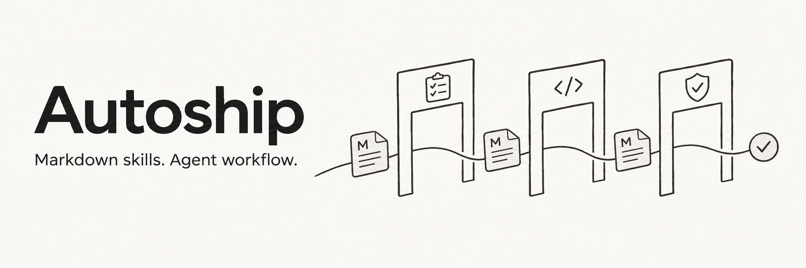
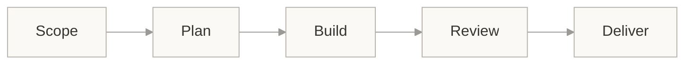
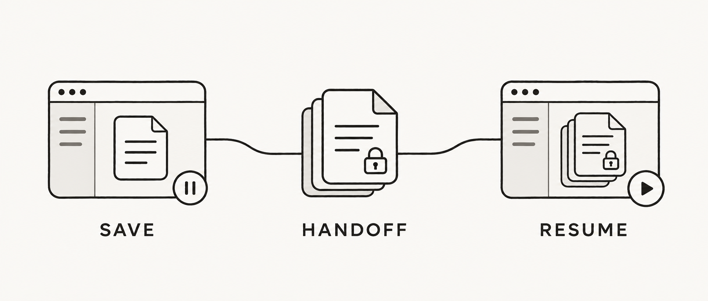

<a id="readme-top"></a>

<p align="center"><a href="README.md">简体中文</a> · <strong>English</strong></p>

<div align="center">

<h1></h1>

<p><strong>From confirmed scope to verified local delivery.</strong></p>

<p>
  <a href="skills/autoship/SKILL.md"></a>
  <a href="CHANGELOG.md"></a>
  <a href="LICENSE"></a>
</p>

<p>
  <a href="#quick-start"><strong>Quick start →</strong></a> &nbsp;·&nbsp;
  <a href="#examples">Examples</a> &nbsp;·&nbsp;
  <a href="#workflow">Workflow</a> &nbsp;·&nbsp;
  <a href="#documentation">Documentation</a>
</p>

</div>

---

Autoship is a set of prompt-only development skills for **new projects, feature work, bug fixes, and interrupted tasks**. Once the scope is confirmed, the agent organizes and advances the work. You make unresolved product decisions without having to say “continue” at every stage.

> **Development status** · The development version is distributed through `main`. Automatic handoff across sessions still awaits real-host end-to-end validation. See [validation status](#validation-status).

## Why Autoship

- **Continuous progress** — The agent organizes investigation, planning, implementation, and repair within the confirmed scope. Small projects may need only 1–2 tasks.
- **Separate sessions** — New projects use a fresh independent session for each planning document, then another for development after planning review and finding resolution. Explain missing capabilities and provide manual handoff.
- **Verifiable delivery** — Acceptance, independent review, and repair evidence determine completion. Task history and remaining work persist.
- **Lightweight setup** — Two Markdown skills reuse your existing tools and authentication. No Autoship runtime is required.

## Quick start

Your host must be able to read files and run the tools your project needs. Completing the required independent review also needs an independent reviewer. Automatic session handoff depends on the host's actual tools and permissions.

### 1. Get the project

```sh
git clone https://github.com/StoneLL1/Autoship.git
cd Autoship
```

You can also download the complete repository. `main` is the development version; record the commit you use for reproducibility.

### 2. Install both skills

Copy the **complete `autoship` and `autoship-docs-sync` directories** from the repository's `skills/` folder into your host's configured skills root. Keep them side by side, with all internal files:

```text
<host skills root>/
├── autoship/
│   ├── SKILL.md
│   ├── assets/
│   ├── references/
│   └── stages/
└── autoship-docs-sync/
    └── SKILL.md
```

Refresh skill discovery as your host requires. See the [installation guide](docs/installation.md) for copy commands, integrity checks, and updates. Update both skills together; active tasks retain their review and repair history.

### 3. Start a task

Invoke `autoship` in your target project. For example:

```text
Use autoship to build a local Markdown reader in <absolute project path>.
Help me clarify the requirements, then proceed to a locally usable result once confirmed.
You may use the host's tools to create a separate independent session for each
planning document, then a fresh development session after planning review passes.
Do not wait for me to say “continue” each time. If host capabilities are insufficient,
explain the limitation and give me a ready-to-send manual handoff prompt.
```

If your host cannot invoke skills natively, ask the agent to read the absolute path to the [entry file](skills/autoship/SKILL.md), with both complete directories accessible. Pasting only the entry text loses its referenced files.

## Examples

<details>
<summary><strong>Existing project: add a feature</strong></summary>

```text
Use autoship to add a table of contents and saved reading position to this project.
Follow the existing design. Once requirements are confirmed, implement, verify,
and deliver locally. You may create a successor session when fresh context is needed.
```

</details>

<details>
<summary><strong>Bug fix: from symptoms to regression checks</strong></summary>

```text
Use autoship to fix <specific symptom> in this project.
The expected behavior is <result>.
Identify the cause, retain regression checks, and complete local delivery.
```

</details>

<details>
<summary><strong>Resume: pick up existing work</strong></summary>

```text
Use autoship to continue the work in <absolute path to the handoff record>.
Check the actual files and session state first. Retain the confirmed scope,
budgets, and review history.
```

</details>

The [examples guide](docs/examples.md) covers more tasks, acceptance criteria, and exceptional cases. Its handoff scenarios are explicitly marked as simulations.

## Workflow



New projects create separate sessions in order for the PRD, design, user flows, technical choices, project conventions, implementation plan, and task specs. Non-frontend projects skip visual design/flow documents; verified existing material can be reused. Once the complete package has one independent review and valid findings are resolved, create a fresh development session. See the [new-project route](skills/autoship/stages/plan-new.md) for completion criteria.

Documents can stay brief and small projects may need only 1–2 implementation tasks. Existing projects update affected material; a new plan still enters development in a fresh session, while active implementation and repairs retain their records. An explicit user request can combine sessions while preserving the planning review gate.

<details>
<summary><strong>Work and completion criteria by scenario</strong></summary>

| Scenario | Main work | Completion criteria |
| --- | --- | --- |
| **New project** | Clarify outcomes and boundaries, investigate references, and produce proportionate product, design, technical, and task plans. | Acceptance is observable, important unknowns are addressed, and the overall plan review is complete with findings resolved. |
| **Feature work** | Trace current behavior, reuse existing patterns, and describe behavior changes and compatibility requirements. | Scope, regression checks, and affected interfaces are clear. |
| **Implementation & repair** | Deliver verifiable increments, run real checks, complete the task's single independent review, then have the main agent repair and verify. | Acceptance passes, valid findings are resolved, and documentation matches the final result. |
| **Handoff or recovery** | Check actual state, ownership, and history, then continue the specific next action. | Takeover is confirmed and no concurrent writer remains. |

</details>

Tasks carry purposeful context references and concrete acceptance criteria. Start from the [task template](skills/autoship/assets/task.md). Implementation and review each load the material they need.

## How session handoff works

<p align="center"></p>
<p align="center"><sub>Concept illustration: save context → transfer write ownership → resume. This is not a real-host screenshot.</sub></p>

1. **Check capabilities** — The agent reads project conventions and identifies the current task and available session, query, and review tools.
2. **Save and release ownership** — At a required document or development session boundary, save a handoff snapshot, record that takeover is pending, and stop changing the workspace and shared record before creating and starting a successor.
3. **Verify and take over** — The successor reads the record, checks the directory and existing results, and registers takeover before writing. The original session checks the takeover result and remains read-only.

- **Independent execution sessions**: With authorization and tools to create, start, query, and access project files, create a session at each required boundary, confirm takeover, and continue.
- **Subagents only**: Use them for independent review and provide manual handoff at required boundaries by default. Substitute child execution only when the user explicitly accepts it and its capabilities are verified; disclose that it is not a new visible chat.
- **Missing session capability or authorization**: Explain what is missing, save and stop writing at the required boundary, and provide a filled handoff prompt with absolute paths for the user to open the next session. Do not silently perform that next stage in the current session.

Prompts cannot add host tools or wake themselves after the host has fully exited. See [session handoff](skills/autoship/references/sessions.md) for the full contract and reusable prompts.

## Delivery and recovery

- **Local delivery**: Report artifact locations, usage, acceptance evidence for the relevant version, review findings and their disposition, and remaining items. Pushing or publishing requires explicit instructions.
- **Persistent task history**: Repair counts, implementation-session counts, and the single review survive handoffs. Changing sessions or rolling back does not reset them. The agent follows recorded budgets; see [recovery rules](skills/autoship/stages/recover.md).
- **Evidence-backed conclusions**: Builds, screenshots, and tests each prove their actual scope. Missing verification conditions or independent review remain explicit pending items; see [acceptance and evidence](skills/autoship/references/quality.md).
- **Workspace preservation**: Keep state and failure evidence outside the task worktree. Consider rollback only for an isolated worktree clearly created by Autoship whose scope can be verified.

## Validation status

File checks, simulated walkthroughs, and real-host execution are recorded separately. The table below summarizes the current validation scope; earlier results do not automatically validate later edits.

| Validation layer | Current record |
| --- | --- |
| Files and distribution | Skill format, local links, isolated copies, and installation-command checks are recorded. |
| Workflow walkthroughs | Earlier versions record 20 static scenarios. This separate-session change has one independent review and 13 static scenarios; neither substitutes for real-host execution. |
| Real-host handoff | **Still untested**: there is no end-to-end evidence of a successor continuing after the original session ends and completing delivery. |

## Documentation

Repository guides are currently in Chinese. The skill files and workflow references are in English.

| What you need | Where to read |
| --- | --- |
| Installation, integrity checks, updates, and troubleshooting | [Installation guide](docs/installation.md) |
| Task, acceptance, and exception examples | [Examples](docs/examples.md) |
| Handoff, acceptance, and recovery | [Sessions](skills/autoship/references/sessions.md) · [Quality](skills/autoship/references/quality.md) · [Recovery](skills/autoship/stages/recover.md) |
| Current capabilities and validation scope | [Session handoff](#how-session-handoff-works) · [Validation status](#validation-status) |
| Version changes | [Changelog](CHANGELOG.md) |

## Contributing

Contributions can include concrete failure scenarios, prompt improvements, and real-host validation records. Read the [contribution guide](CONTRIBUTING.md) first. Keep entry points short, shared rules in one place, and check links and standalone distribution integrity.

## Acknowledgments

Workflow methods draw on the Wiki knowledge base, Trellis, Superpowers, and OpenSpec. README structure and presentation draw on [Awesome README](https://github.com/matiassingers/awesome-readme) and [Best README Template](https://github.com/othneildrew/Best-README-Template).

## License

Released under the [MIT License](LICENSE).

<p align="right"><a href="#readme-top">Back to top ↑</a></p>
