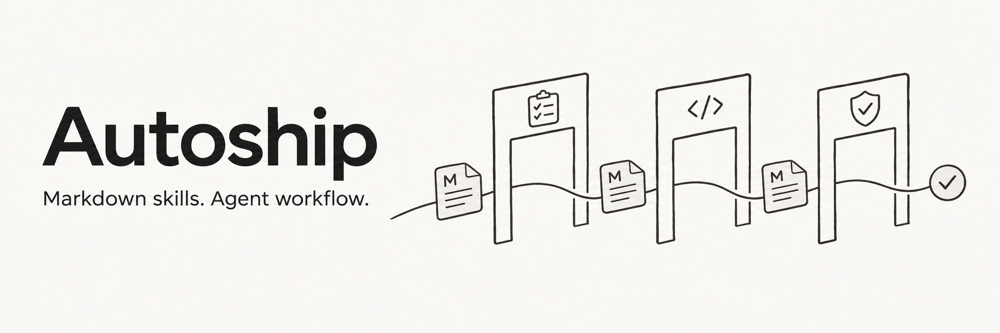
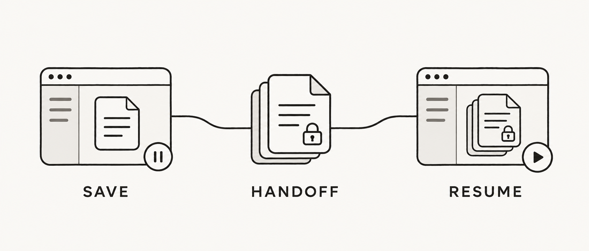

<a id="readme-top"></a>

<p align="center"><strong>简体中文</strong> · <a href="README.en.md">English</a></p>

<div align="center">

<h1></h1>

<p><strong>从已确认的需求，到可验证的本地交付。</strong></p>

<p>
  <a href="skills/autoship/SKILL.md"></a>
  <a href="CHANGELOG.md"></a>
  <a href="LICENSE"></a>
</p>

<p>
  <a href="#开始使用"><strong>快速开始 →</strong></a> &nbsp;·&nbsp;
  <a href="#使用示例">使用示例</a> &nbsp;·&nbsp;
  <a href="#工作流程">工作流程</a> &nbsp;·&nbsp;
  <a href="#文档导航">文档导航</a>
</p>

</div>

---

Autoship 是一套纯提示词的开发流程 Skills，适用于**新项目、功能迭代、缺陷修复与中断续跑**。确认范围后，Agent 自行组织任务并连续推进；你参与尚未决定的产品取舍，不必逐阶段说“继续”。

> **开发状态** · 当前通过 `main` 分发开发版。真实宿主的跨 session 自动接力闭环仍待验收，具体范围见 [验证状态](#验证状态)。

## 为什么使用 Autoship

- **连续推进** — Agent 安排已确认范围内的调查、规划、实现与修复，小项目可以只用 1–2 个任务。
- **分阶段接力** — 新项目默认为各份规划文档分别新建独立 session；规划审核通过后再新建开发 session，能力不足时明确说明并提供人工接力。
- **可验证交付** — 用验收、独立审核和修复证据判断完成，保留任务历史与剩余项。
- **轻量分发** — 两个 Markdown Skill，复用现有工具与登录，无需 Autoship 运行时。

## 开始使用

宿主需要能读取文件并执行项目所需工具；完成规定的独立审核还需要独立 reviewer 能力。自动跨会话接力取决于宿主实际提供的工具与权限。

### 1. 获取项目

```sh
git clone https://github.com/StoneLL1/Autoship.git
cd Autoship
```

也可以下载完整仓库。`main` 是当前开发版，建议记录所用提交以便复现。

### 2. 安装两个 Skill

把仓库 `skills/` 下的 **`autoship` 与 `autoship-docs-sync` 两个完整目录**复制到宿主配置的 Skills 根目录，保持并列并保留内部文件：

```text
<宿主 Skills 根目录>/
├── autoship/
│   ├── SKILL.md
│   ├── assets/
│   ├── references/
│   └── stages/
└── autoship-docs-sync/
    └── SKILL.md
```

按宿主方式重新发现 Skills。具体复制命令、安装自检和更新步骤见 [安装指南](docs/installation.md)。更新时两个 Skill 需要一起更新，活跃任务继续继承原审核与修复记录。

### 3. 发起任务

在目标项目中调用 `autoship`，例如：

```text
用 autoship 帮我做一个本地 Markdown 阅读器，项目目录是 <绝对路径>。
先帮我明确需求；确认后自动推进到本地可用。
允许使用宿主提供的工具，为各份规划文档分别新建独立 session，
规划审核通过后再新建 session 执行开发，不必逐次等我说继续。
宿主能力不足时说明原因，并给我可直接用于新会话的人工接力提示词。
```

不支持原生 Skills 调用时，让 Agent 读取 [入口文件](skills/autoship/SKILL.md) 的绝对路径，并确保两个完整目录可访问；只粘贴入口正文会丢失引用。

## 使用示例

<details>
<summary><strong>已有项目：追加功能</strong></summary>

```text
用 autoship 给当前项目增加目录导航和阅读位置记忆，沿用现有设计。
确认需求后自动实现、验证和交付；需要新上下文时可自动新建 session 接力。
```

</details>

<details>
<summary><strong>缺陷修复：从症状到回归检查</strong></summary>

```text
用 autoship 修复当前项目的 <具体症状>，预期行为是 <结果>。
先定位原因，保留回归检查，再完成本地交付。
```

</details>

<details>
<summary><strong>中断续跑：接手已有工作</strong></summary>

```text
用 autoship 继续 <交接记录绝对路径> 中的工作。
先核对实际文件和会话状态，沿用已确认范围、预算和审核记录。
```

</details>

更完整的任务、验收与异常示例见 [使用示例指南](docs/examples.md)，其中的接力情境均明确标为模拟。

## 工作流程


新项目先按 grill-me 方式多轮澄清，沿需求的依赖关系追问到范围与取舍清楚；随后由两个子代理分别调研同类产品和实现方法／开源复用，前端项目最后由用户选择设计风格。完整问答、决定理由、两份调研和设计选择通过 [澄清上下文](skills/autoship/references/discovery.md) 交给 PRD 会话。

之后默认依次新建独立 session 完成 PRD、设计、用户流程、技术方案、项目约定、实施计划和任务清单；非前端项目跳过视觉设计与流程文档，已核对有效的材料可复用。完整规划包经过一次独立审核并解决有效发现后，再新建开发 session。具体出口见 [新项目路线](skills/autoship/stages/plan-new.md)。

PRD 按需求完整度决定篇幅，覆盖用户故事、行为规则、边界与验收；开发任务数量仍按难度决定，小项目可只用 1–2 个任务。已有项目按影响范围更新材料；新规划进入开发时同样新建 session，已在执行的任务续跑和修复则继承当前记录。用户明确要求合并会话时可以调整，但保留规划审核门槛。

<details>
<summary><strong>各场景的工作与完成条件</strong></summary>

| 场景 | 主要工作 | 完成条件 |
| --- | --- | --- |
| **新项目** | 澄清结果与边界，调查参考，形成相称的产品、设计、技术与任务计划。 | 验收可观察，重要未知已处理，整体规划审核完成并解决发现。 |
| **功能迭代** | 追踪当前行为，复用现有模式，描述行为差异与兼容要求。 | 变更范围、回归检查和受影响接口清楚。 |
| **实现与修复** | 交付可验证增量，真实执行检查，完成任务唯一一轮独立审核，由主 Agent 修复验证。 | 验收通过，有效发现已处理，文档与最终结果一致。 |
| **接力或恢复** | 核对实际状态、所有权和历史，继续具体下一步。 | 已确认接手，且没有并发写入者。 |

</details>

任务携带带目的的上下文路径与具体验收，可从 [任务模板](skills/autoship/assets/task.md) 开始。实现和审核各按需要读取材料。

## 自动接力如何工作

<p align="center"></p>
<p align="center"><sub>接力概念图：保存上下文 → 交出写入权 → 后继接手。非真实宿主运行截图。</sub></p>

1. **确认能力** — Agent 读取项目约定，确认当前任务及可用的会话、查询和审核工具。
2. **保存并交出写入权** — 到达规定的文档或开发会话边界时，保存交接快照、登记等待接手，停止修改工作区和共享交接记录，再创建并启动后继会话。
3. **核对并接手** — 后继读取记录、核对目录与已有结果，确认并登记接手后开始写入；原会话查询接手结果并保持只读。

- **有独立执行会话工具**：能创建、启动、查询并访问项目文件且已获授权时，在规定边界新建会话，确认接手后继续。
- **只有子代理**：可用于调研与独立审核；默认仍在规定边界提供人工接力。用户明确接受子代理替代执行且能力核实后才可替代，并说明它不是新的可见聊天。
- **缺少会话能力或授权**：明确说明缺少什么，在规定边界保存并停止写入，给出已填好的接力提示词和绝对路径，由用户开启下一会话；不会静默留在原会话完成下一阶段。

提示词不能增加宿主工具，也不能在宿主完全退出后自行唤醒。完整约定与接力提示词见 [会话接力](skills/autoship/references/sessions.md)。

## 交付与恢复

- **本地交付**：给出成果位置、使用方法、对应版本的验收证据、审核发现的处置与剩余项。推送或发布需要明确指示。
- **历史随任务保留**：修复次数、实现会话次数和唯一一轮审核随交接保留；更换会话或回退不重置。预算由 Agent 根据记录遵守，详见 [恢复规则](skills/autoship/stages/recover.md)。
- **证据对应结论**：构建、截图与测试各说明实际证明范围；缺少验证条件或独立审核能力时，如实保留待验、待审核状态，详见 [验收与证据](skills/autoship/references/quality.md)。
- **保留用户工作区**：状态与失败证据放在任务工作树之外；只对明确由 Autoship 创建且范围可核对的隔离工作树考虑回退。

## 验证状态

文件校验、模拟情境走查与真实宿主执行分别记录。下表概述当前验证范围；历史版本的通过不自动覆盖后续修改。

| 验证层级 | 当前记录 |
| --- | --- |
| 文件与分发 | 已记录 Skill 格式、本地引用、隔离复制及安装命令检查。 |
| 流程走查 | 历史记录保留；最新 Clarify/PRD 改动完成一轮独立审核、发现修复与 22 个静态模拟情境。均不代替真实宿主执行。 |
| 真实宿主接力 | **仍待实测**：尚无后继在原会话结束后继续执行并完成交付的闭环证据。 |

## 文档导航

| 想了解什么 | 阅读入口 |
| --- | --- |
| 安装、自检、更新与故障定位 | [安装指南](docs/installation.md) |
| 任务、验收与异常处理示例 | [使用示例](docs/examples.md) |
| 接力、验收与失败恢复 | [会话接力](skills/autoship/references/sessions.md) · [验收与证据](skills/autoship/references/quality.md) · [恢复规则](skills/autoship/stages/recover.md) |
| 当前能力与验证范围 | [自动接力](#自动接力如何工作) · [验证状态](#验证状态) |
| 版本变化 | [CHANGELOG](CHANGELOG.md) |

## 参与贡献

欢迎提交具体失败情境、提示词改进与真实宿主验证记录。修改前请阅读 [贡献指南](CONTRIBUTING.md)；保持入口简短、共享规则单一，并检查引用与独立分发完整性。

## 致谢

流程方法参考 Wiki 知识库、Trellis、Superpowers 与 OpenSpec。README 的结构与排版参考 [Awesome README](https://github.com/matiassingers/awesome-readme) 和 [Best README Template](https://github.com/othneildrew/Best-README-Template)。

## 许可证

基于 [MIT License](LICENSE) 开源。

<p align="right"><a href="#readme-top">返回顶部 ↑</a></p>
